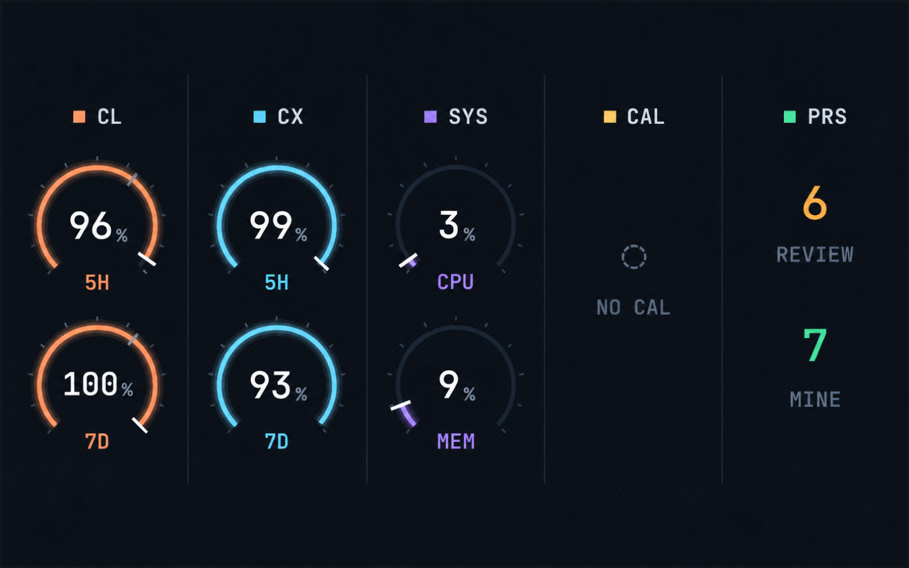

# Herdr Instrument Panel

A collapsible cockpit sidebar for Herdr: Claude and Codex quota, system vitals, your next meeting, and GitHub PR radar.



Gallery build brief: [RECIPE.md](RECIPE.md). Each mod folder includes its helpers so an agent can copy it directly.

## Package

Instrument-panel mods for the [Herdr](https://herdr.dev) desktop app, stacked in one right-hand column that the tab-bar readout shows and hides:

| Mod | Shows | Data | Per-machine config (optional) |
|---|---|---|---|
| `quota` | Claude / Codex subscription limits left | Claude Code login, Codex session logs | `~/.config/herdr-quota/accounts.json` |
| `vitals` | CPU, memory, disk, battery gauges, CPU trace, load, thermal | `iostat`, `memory_pressure`, `pmset`, `df` (macOS); `/proc`, `/sys` (Linux) | none |
| `nextup` | countdown ring to your next meeting, JOIN button, rest of the day | iCalendar feed URLs | `~/.config/herdr-mods/nextup.json` (**required** to show events) |
| `fleet` | Every agent running in Herdr: blocked, working, done; click to focus it | Herdr's live agent list | none |
| `pipelines` | Your latest GitHub Actions runs per repo, branch and workflow | `gh` CLI | `~/.config/herdr-mods/pipelines.json` (optional) |
| `jira` | Your open tickets: blocked, in progress, to do | Jira Cloud REST API | `~/.config/herdr-mods/jira.json` (**required**) |
| `prs` | PRs awaiting your review, your open PRs, CI and review state | `gh` CLI (its logged-in account) | `~/.config/herdr-mods/prs.json` |

`./install.sh` installs all seven; `./install.sh quota vitals` installs a subset. The compact button (`›‹`) in the quota header shrinks the whole column, and every mod switches to a small form when its column is narrower than 170px.

## Showing and hiding sections

The tab bar holds a strip of chips (`VIT NXT PRS FLT CI JIRA`), one per stacked mod. A lit chip means the section is shown. Click a chip to show or hide that section; the others share the freed space. Each section header also has a `✕` that hides it. Clicking a chip while the whole column is hidden shows the column first. Herdr remembers the choices across restarts. From a key binding: `layout.toggle {"id": "fleet"}` (ids: `vitals`, `nextup`, `prs`, `fleet`, `pipelines`, `jira`).

## Fleet, pipelines and jira

- **fleet**: no config. Blocked agents sort first. The age is how long this mod has seen the agent in its current status.
- **pipelines**: shows one row per repo, branch and workflow. With no config it scans the repos of your open PRs (up to 6). Config: `{ "repos": ["acme/api"], "limit": 12, "pollSeconds": 120, "hostname": "github.com" }`.
- **jira**: needs an Atlassian API token. Config `~/.config/herdr-mods/jira.json`: `{ "site": "acme.atlassian.net", "email": "you@acme.com", "tokenCommand": "security find-generic-password -s herdr-jira -w", "jql": "...", "limit": 15, "pollSeconds": 180 }`. Prefer `tokenCommand` (a keychain lookup) over `token`, so no secret sits in the file. The token goes to `curl` on stdin, never on the command line. The default JQL is your open assigned tickets.

## The quota mod

A [Herdr](https://herdr.dev) desktop-app mod that shows how much of your **Claude** and **Codex** subscription limits is left: a sci-fi gauge panel at the side of the window, plus a compact readout in the tab bar (`● CL 89 | ● CX 100`) that shows and hides it.

For each account it shows:

- the 5-hour (session) window and the weekly window, as % left on an arc gauge;
- the time until each window resets;
- the pace (NOMINAL / ELEVATED / OVERBURN / DEPLETED) and the projected usage at reset;
- a grey tick on each gauge marking where an even burn would put you right now.

**Compact mode** (for laptop screens): the `›‹` button in the panel header shrinks the panel to a slim column of small gauges stacked on top of each other, with just the % left and the window (5H / 7D). Click `‹›` or any small gauge to go back to the full panel at its previous width. Your choice is remembered across restarts. You can also switch from a key binding or the CLI with the commands `quota.compact`, `quota.expand` and `quota.toggle-compact` (e.g. `herdr-app do quota.toggle-compact`, or bind one in `keys.json`).

Nothing in this repo is tied to one person. Each machine reads **its own** logins: whatever Claude Code and Codex are signed into there, or the accounts listed in that machine's config file.

## Install on a new machine (for an agent: follow these steps in order)

**Prerequisites:**
- the Herdr desktop app, running, with `herdr-app` on `PATH` (opened at least once, so `~/.config/herdr-app` exists);
- `git` and `python3` (`python3` is only needed for the layout step);
- per mod: `quota` needs Claude Code and/or Codex signed in on this machine; `prs` needs the GitHub CLI `gh`, logged in; `nextup` needs a calendar feed URL from the person; `vitals` needs nothing.

**1. Clone and install:**
```sh
git clone https://github.com/sh9zad/herdr-quota.git ~/Repos/herdr-quota
cd ~/Repos/herdr-quota && ./install.sh                               # all four; or e.g. ./install.sh quota vitals
```
The installer:
- copies each chosen `mods/<name>/` to `~/.config/herdr-app/mods/<name>/`, writing `mod.json` first so Herdr doesn't auto-dock a stray copy;
- copies `shared/hud.js` into `vitals`, `nextup` and `prs`;
- runs `herdr-app check` on each mod, and stops at the first failure;
- edits the **layout that's currently shown**:
  - adds the tab-bar readout (`quota-toggle`) right after the `tabs` block;
  - adds a right-hand column (`quota-panel`) next to the active-tab block, holding `quota` with the other mods stacked under it;
  - if that layout is one of Herdr's shipped ones (`main`, `terminals`, `win98`), which can't change structure, it first clones it to `<name>-quota` and switches to the clone;
  - backs up the layout as `*.bak-quota-<time>` before any change;
- is idempotent: running it again only adds what's missing.

**2. Verify:**
- The installer's last line before `done` should be `ok: no herdr errors`; `herdr-app status` should show `"errors": []`.
- `herdr-app shot /tmp/herdr.png`, then look at the image. It should show:
  - the `● CL nn | ● CX nn` readout in the tab bar;
  - the column on the right: QUOTA, then SYSTEM // VITALS, CHRONO // NEXT UP and GITHUB // PR RADAR.
- If the column is hidden, click the readout or run `herdr-app do layout.show --id quota-panel`.
- If a second, full-height copy of a mod appears, Herdr auto-docked it. Delete that layout node: the one whose `content.mod` is one of these mods but whose id isn't `quota-toggle`, `quota`, `vitals`, `nextup` or `prs`.

**3. Per-machine setup:**
These files live outside the repo and are never committed. Don't put their contents in the repo, a commit or a PR.
- **quota**: usually nothing to do; the Claude Code and Codex logins are auto-detected (see *Accounts* below). On macOS the first read may make the system ask whether `security` can access the "Claude Code-credentials" keychain item; tell the person to choose **Always Allow**.
- **prs**: run `gh auth status`. If it's not logged in, ask the person to run `gh auth login` themselves. Optional filters go in `~/.config/herdr-mods/prs.json` (see *PR radar config*).
- **nextup**: shows "NO CALENDAR LINKED" until configured.
  - Ask the person for their calendar's iCal feed URL (Google: Settings → the calendar → *Integrate calendar* → *Secret address in iCal format*), and for their email so declined events are hidden.
  - Write `~/.config/herdr-mods/nextup.json` as in *Next-up calendar config*. The URL is a secret: offer to let them paste it into the file themselves.
  - The panel picks the file up within 30 s, or straight away from its ↻ button.
- **vitals**: nothing.

**4. Wiring the layout by hand** (only if the script can't place things, e.g. a custom layout without a `tabs` block):
- Edit `~/.config/herdr-app/layouts/<shown layout>.json`. Never edit a shipped layout; clone it first with `herdr-app do layout.clone --name main --as main-quota`.
- Toggle, inside the row that holds the tab bar:
  `{"id":"quota-toggle","type":"block","size":{"px":150},"content":{"mod":"quota","props":{"role":"toggle"}}}`
- Column, inside the row that holds the `{"tab":"active"}` block. Keep the ids; the toggle and compact button act on `quota-panel`:
  ```json
  {"id":"quota-panel","type":"column","hidden":false,"size":{"px":400},"min":80,"max":640,"children":[
    {"id":"quota","type":"block","size":{"weight":5},"content":{"mod":"quota"}},
    {"id":"vitals","type":"block","size":{"weight":3},"min":60,"content":{"mod":"vitals","props":{"panel":"quota-panel"}}},
    {"id":"nextup","type":"block","size":{"weight":2},"min":60,"content":{"mod":"nextup","props":{"panel":"quota-panel"}}},
    {"id":"prs","type":"block","size":{"weight":3},"min":60,"content":{"mod":"prs","props":{"panel":"quota-panel"}}}
  ]}
  ```
- Herdr applies the change live. If the file is invalid, it writes the reason to `layout.error` next to it.

**Update:** `cd ~/Repos/herdr-quota && git pull && ./install.sh`. Per-machine config is never touched.

**Uninstall:**
- remove `~/.config/herdr-app/mods/{quota,vitals,nextup,prs}/`;
- delete the `quota-toggle` and `quota-panel` nodes from the layout. If the installer wrapped the tab bar in a `quota-tabs-row` row, unwrap it, or restore a `*.bak-quota-*` backup.

## Accounts: auto-detect or `~/.config/herdr-quota/accounts.json`

**With no config file**, each machine auto-detects:

| Provider | Where the login comes from |
|---|---|
| Claude | the macOS keychain item `Claude Code-credentials`; otherwise `${CLAUDE_CONFIG_DIR:-~/.claude}/.credentials.json` (Linux) |
| Codex | `${CODEX_HOME:-~/.codex}/sessions` |

**To choose accounts yourself**, or to track more than one, create `~/.config/herdr-quota/accounts.json` on that machine. It lives outside the mod folder, so reinstalling never overwrites it. Start from `accounts.example.json`:

```json
{
  "accounts": [
    { "provider": "claude", "name": "Personal", "credentials": { "keychain": "Claude Code-credentials" } },
    { "provider": "claude", "name": "Work", "credentials": { "file": "~/.claude-work/.credentials.json" } },
    { "provider": "codex",  "name": "Codex", "home": "~/.codex" }
  ],
  "poll": { "claudeSeconds": 180, "codexSeconds": 60 }
}
```

- `provider`: `"claude"` or `"codex"`. Each account gets its own card. The tab-bar number is the lowest "% left" for that provider across its accounts.
- `name`: the card title. Set `"enabled": false` to hide an account without deleting it.
- Claude `credentials` takes one of:
  - `{ "keychain": "<service>" }` (macOS; add `"keychainAccount"` if one service holds several items). The default Claude Code config uses `Claude Code-credentials`. A Claude Code run with a different `CLAUDE_CONFIG_DIR` stores a suffixed service; find it with `security dump-keychain | grep "Claude Code"`.
  - `{ "file": "<path>" }`: a Claude Code `.credentials.json` (Linux, or a non-default config dir).
- Codex `home`: that account's `CODEX_HOME` directory (default `~/.codex`).
- The config is re-read on every poll, so you can edit it without restarting anything. If the JSON is invalid, the panel header says `BAD CONFIG`.
- Credentials never leave the machine except as the bearer token sent to `api.anthropic.com`. No secret is stored in this repo or in the config file. The config only says *where* each login lives.

## How the numbers are read

- **Claude**: the mod reads the Claude Code OAuth token and calls `GET https://api.anthropic.com/api/oauth/usage` with header `anthropic-beta: oauth-2025-04-20`. This is the same data Claude Code's `/usage` shows. The endpoint is **undocumented** and could change; the parsing is in `readClaude` in `mods/quota/data.js`. An expired token shows `TOKEN EXPIRED`. Running `claude` once refreshes it.
- **Codex**: Codex writes `rate_limits` snapshots into its session logs (`<CODEX_HOME>/sessions/**/rollout-*.jsonl`). The mod reads the newest snapshot from the last 8 days, so these numbers only update when Codex runs. The card shows `CACHED` and the time of the last signal when that was over an hour ago. A window whose reset time has passed shows as full (`ROLLED`).
- **Polling**: the tab-bar readout is always drawn, so it does the polling (Claude every 180 s, Codex every 60 s by default). It publishes the results through Herdr shared state; the panel only reads them, and its RESYNC button forces a refresh. Because of this, the toggle needs to be in the layout even if you mostly keep the panel open.

## Next-up calendar config: `~/.config/herdr-mods/nextup.json`

```json
{
  "calendars": [
    { "name": "Work", "ics": "https://calendar.google.com/calendar/ical/.../private-.../basic.ics" },
    { "name": "Home", "file": "~/calendars/home.ics", "enabled": false }
  ],
  "me": ["you@company.com"],
  "hideAllDay": true,
  "ignore": ["^Focus time$", "^Lunch"],
  "lookaheadHours": 36,
  "refreshMinutes": 10
}
```

- **Google Calendar**: Settings → pick the calendar → *Integrate calendar* → **Secret address in iCal format**. Outlook: *Publish a calendar* → ICS link. iCloud: share as a *Public Calendar* (`webcal://` works).
- The URL is a secret (anyone with it can read the calendar). It stays in this machine's config file only.
- `me`: your attendee emails, so events you **declined** are skipped. `ignore`: regexes on titles. `hideAllDay`: default true.
- Recurring events, exceptions, moved/cancelled instances and timezones are handled (`mods/nextup/ics.js`). The mod runtime has no `Intl`, so offsets come from the system tz database via `date`.
- Click the ring (compact) or **JOIN** to open the Meet / Zoom / Teams / Webex link found in the event.

## PR radar config: `~/.config/herdr-mods/prs.json`

Optional. It uses whatever account `gh` is logged in to (`gh auth login`; `gh auth status` to check).

```json
{ "filter": "org:acme", "includeTeamReviews": false, "limit": 15, "pollSeconds": 120, "hostname": "github.com" }
```

- `filter`: extra GitHub search qualifiers (e.g. `org:acme`, `repo:acme/api`).
- `includeTeamReviews`: also count reviews requested from your teams (default: only requests to you by name).
- `hostname`: for GitHub Enterprise.
- Click a row to open the PR. In compact form, click a counter to open GitHub's list.

## Vitals

No config. Polls every 5 s while the column is shown, and skips polling while it's hidden. Gauges turn amber at 75% and red at 90% (battery: amber at 25%, red at 10%, green while charging).

## Files

```
mods/quota/            main.js (view; role "toggle" = tab-bar readout + poller), data.js (accounts, readers, pace)
mods/vitals/main.js    system gauges
mods/nextup/           main.js (view, tz lookup), ics.js (iCalendar parser + recurrence expansion)
mods/prs/main.js       GitHub PR radar
mods/fleet/main.js     Herdr agents list
mods/pipelines/main.js GitHub Actions runs
mods/jira/main.js      Jira tickets
shared/hud.js          the shared look (palette, gauge, sparkline, frame); install.sh copies it into vitals/nextup/prs
install.sh             copy + check + stack into the shown layout
scripts/add-to-layout.py   idempotent layout patcher (toggle after `tabs`; column next to the active tab; --stack)
accounts.example.json  quota config template
```

Look and tuning: colors are in `C` and `ACCENT` at the top of `main.js`. The warning levels (amber at ≤25% left, red at ≤10%) are in `level()`, and the pace rules are in `pace()` in `data.js`. Herdr's mod API reference is `~/.config/herdr-app/AGENTS.md`, `herdr.d.ts` and `gpui-kit.d.ts` on any machine with the app installed. After any edit, run `herdr-app check ~/.config/herdr-app/mods/quota`.
