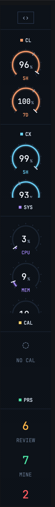

# Herdr Instrument Panel

A collapsible instrument column beside your terminals: orange Claude and cyan Codex subscription gauges, purple system vitals, a yellow next-meeting countdown, and green GitHub PR radar. A compact tab-bar readout shows remaining quota even with the column hidden. Add the bundle to the user's own window; each panel can also be used separately, with the quota toggle required for quota polling.

## What you see

The right column is 400px wide, resizable between 80 and 640px. From top to bottom: QUOTA, SYSTEM // VITALS, CHRONO // NEXT UP, and GITHUB // PR RADAR, with height weights 5:3:2:3. The latter three have a 60px minimum height. Below 170px the panels use compact gauges and counters. The quota compact button sets the column to 92px.

Use a near-black instrument background (#080B10), dark plates (#101722), fine blue-grey borders (#1B2533), pale text (#D6E2F0), and monospaced labels. Accents: Claude #FF9E6B, Codex #6CD6FF, vitals #A98BFF, calendar #FFD36B, PRs #4BE3A4. Arc gauges, fine ticks and CPU history provide the instrument look.

Quota shows each account's five-hour and weekly percent remaining, reset countdown, pace and projected usage. Vitals shows CPU, memory, disk, battery, load and thermal data where available. Next Up shows the next timed event, countdown and meeting link plus the day's events. PR Radar separates reviews requested from your open PRs and shows CI/review state.

## How it behaves

Click the CL/CX tab-bar readout to show or hide the column. Click the quota compact button to shrink it; click a compact quota gauge to restore its remembered wide size. RESYNC refreshes quota; the close button hides the column. Commands quota.compact, quota.expand and quota.toggle-compact provide the same width controls; no keys are required.

Quota warns at 25% remaining and turns red at 10%. It reports NOMINAL, ELEVATED, OVERBURN or DEPLETED pace, and marks stale Codex signals CACHED and elapsed windows ROLLED. Missing logins and invalid configuration have explicit states. Calendar without configuration says NO CALENDAR LINKED. Click JOIN (or its compact ring) to open the detected meeting URL. Click a PR row or compact counter to open GitHub. Refresh controls reload the corresponding data. Agent working/blocked/done/idle states are handled by the existing layout; this bundle does not display or change them.

Quota's always-visible toggle polls Claude every 180 seconds and Codex every 60 seconds by default, sharing results with the panel. Other panels skip polling while their containing panel is hidden. Vitals polls every five seconds; calendar and PR configuration control their refresh intervals.

## Built from

Copy mods/quota, mods/vitals, mods/nextup and mods/prs, including the bundled hud.js files. Keep mod.json place set to none. Read every source before installing. Use native gpui-kit and gpui-base elements; shared/hud.js is the editable source of the three bundled helper copies.

In a clone of the user's layout, add a 150px block with id quota-toggle and content {mod: "quota", props: {role: "toggle"}} next to the tabs block. Beside the active-tab block add a column with id quota-panel and the sizes above. Its children are quota, vitals, nextup and prs blocks referencing their namesake mods. Pass props {panel: "quota-panel"} to the latter three. The exact JSON is in README.md; scripts/add-to-layout.py implements this insertion. There is intentionally no layouts folder: this is a mod bundle for an existing window.

Use herdr layout, settings, shared/setShared, nextCommand and layout.toggle/hide/resize for panel state and commands. Data readers use home, readTextFile, exec and fetch. The quota main view has panel and toggle roles. The toggle owns polling even while the column is hidden.

Claude reads its local OAuth credentials via macOS security or a credentials file and sends its bearer token to api.anthropic.com/api/oauth/usage. Codex scans local session JSONL rate-limit snapshots. Vitals executes macOS system utilities or reads Linux /proc and /sys. Calendar reads local ICS files or fetches configured URLs, uses date for timezone offsets and handles recurrence/exceptions. PRs executes the authenticated gh CLI. Link actions execute open or xdg-open. These mods access files outside their folders, execute local programs and reach the network; disclose this before installing.

## Watch out

Read the installed Herdr AGENTS.md and type files first. Never overwrite a shipped layout or an existing mod. Clone shipped layouts before wiring. The installer updates existing names; if there is a collision, an agent must rename the incoming mods and their references before installation. Keep quota-panel consistent with quota's toggle and compact actions. Inspect the layout and adapt manually if its tab bar differs from the installer's expected tabs block. Do not replace keys.json.

Keep user configurations outside the repo: ~/.config/herdr-quota/accounts.json, ~/.config/herdr-mods/nextup.json and ~/.config/herdr-mods/prs.json. Never publish OAuth tokens, secret calendar URLs, session logs or personal config. Every user's machine supplies its own credentials. No calendar is required; the empty state works without one. Claude's usage endpoint is undocumented and can change. Codex data updates only when Codex emits snapshots. macOS and Linux are supported by the data readers; Windows is not validated. Compact quota content can be clipped in a short window with many accounts; allow enough height or use wide mode.

## Done when

All four copied mod folders pass herdr-app check without the installer supplying missing helper files. The shown layout has no Herdr errors. Visually verify wide and compact modes in the app, toggle show/hide, restore width, and refresh. Confirm no-calendar and unauthenticated states render cleanly; with local configuration, verify quota readings, system gauges, event countdown/JOIN and PR links. Restart to verify remembered compact state. Ensure personal files and terminal contents are absent from the published preview.
